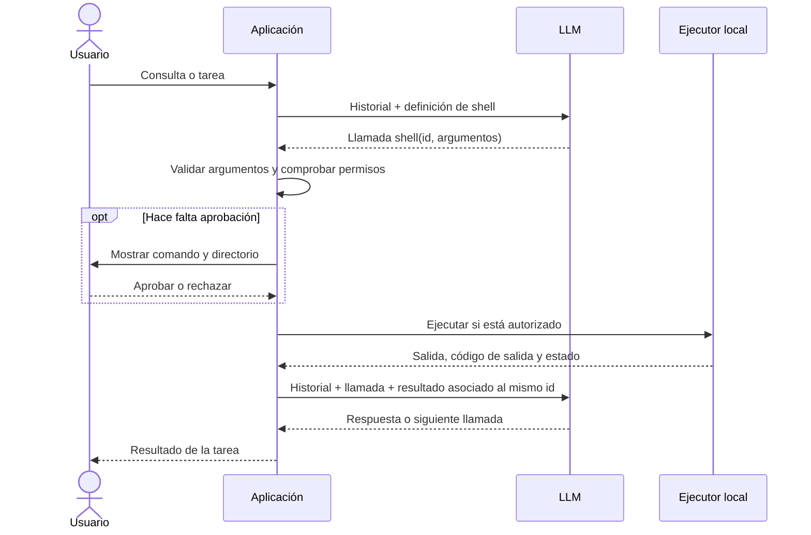

# Integrar ejecución de terminal en una aplicación con LLM

El LLM genera una llamada estructurada a una herramienta. Tu aplicación valida esa llamada, decide si autorizarla, ejecuta un proceso y devuelve el resultado al modelo. La herramienta se ejecuta donde corre tu backend o agente local; una API de LLM no obtiene acceso a tu máquina por recibir su descripción.

Esta guía explica la implementación de OpenCode y muestra una base independiente del proveedor para tu aplicación. El ejemplo usa JavaScript y Node.js, sin dependencias externas. No requiere importar los paquetes internos de OpenCode.

## 1. Arquitectura



Necesitas cuatro piezas:

| Pieza | Responsabilidad |
| --- | --- |
| Adaptador del LLM | Enviar definiciones de herramientas y convertir respuestas del proveedor a llamadas estructuradas. |
| Registro de herramientas | Resolver el nombre solicitado, validar argumentos y llamar al ejecutor correspondiente. |
| Política de permisos | Evaluar las reglas de tu aplicación y, cuando corresponda, esperar aprobación. |
| Ejecutor | Crear procesos, capturar salida y comunicar finalización o errores. |

No ejecutes comandos extraídos de texto libre o de bloques Markdown de la respuesta. Usa el mecanismo de llamadas a herramientas de tu proveedor.

## 2. Cómo lo implementa OpenCode

Estas referencias apuntan al código del repositorio donde está esta guía:

| Archivo | Qué buscar |
| --- | --- |
| [tool/plugin/shell.ts](packages/core/src/tool/plugin/shell.ts) | `Input`, registro de `shell`, `prepare`, permisos y ejecución. |
| [tool.ts](packages/core/src/tool.ts) | Registro, snapshot de definiciones y resolución del ejecutor. |
| [tool/runtime.ts](packages/core/src/tool/runtime.ts) | Validación de argumentos y normalización de resultados. |
| [session/model-request.ts](packages/core/src/session/model-request.ts) | Definiciones enviadas al modelo y enlace con `executeTool`. |
| [session/runner/step.ts](packages/core/src/session/runner/step.ts) | `llm.stream(...)` y ejecución al recibir `tool-call`. |
| [shell.ts](packages/core/src/shell.ts) | `Shell.create` y creación real del proceso mediante `environment.spawner.spawn`. |
| [shell/select.ts](packages/core/src/shell/select.ts) | Selección del shell y construcción de sus argumentos. |
| [permission.ts](packages/core/src/permission.ts) | Evaluación de reglas `allow`, `deny` y `ask`. |
| [session/runner/to-llm-message.ts](packages/core/src/session/runner/to-llm-message.ts) | Conversión de llamadas y resultados persistidos al historial del LLM. |

La herramienta `shell` de OpenCode acepta `command`, `workdir`, `timeout` y `background`. Los comandos en primer plano tienen un timeout predeterminado de dos minutos; los de segundo plano no tienen timeout por defecto.

Antes de crear el proceso, la herramienta resuelve el directorio, analiza el comando con `ShellParse.scan`, comprueba accesos externos y aplica `Permission.assert` a los comandos detectados. El registro valida los argumentos, pero la autorización de ejecución pertenece a la herramienta.

`Shell.create` prepara las variables de entorno y lanza el shell con su comando. En shells POSIX se usa `-c`; PowerShell y CMD tienen otros argumentos. La salida combinada se almacena en un archivo y se devuelve una vista acotada al modelo. Los trabajos en segundo plano generan una notificación al terminar.

OpenCode persiste eventos y resultados de sesión, y reconstruye el historial antes de continuar. El bucle en memoria de esta guía es una simplificación para una integración inicial en tu propia aplicación.

## 3. Definición de la herramienta

La definición anuncia lo que el modelo puede solicitar. No contiene el ejecutor ni concede permisos.

En el ejemplo mantenemos el directorio bajo control de la aplicación y usamos un timeout fijo. Esto reduce los parámetros necesarios para comenzar. Guarda este bloque como `terminal.mjs`:

```js
import { spawn } from "node:child_process"
import { realpath } from "node:fs/promises"

export const shellDefinition = {
  name: "shell",
  description: "Ejecuta un comando en el directorio de trabajo de la aplicación y devuelve su salida.",
  inputSchema: {
    type: "object",
    properties: {
      command: { type: "string", minLength: 1, maxLength: 8000 },
    },
    required: ["command"],
    additionalProperties: false,
  },
}

export function parseShellInput(value) {
  if (
    value === null ||
    typeof value !== "object" ||
    Array.isArray(value) ||
    Object.keys(value).some((key) => key !== "command") ||
    typeof value.command !== "string" ||
    value.command.trim().length === 0 ||
    value.command.length > 8000 ||
    value.command.includes("\0")
  ) {
    throw new Error("Argumentos inválidos para shell")
  }
  return { command: value.command }
}

export async function createShell({ workspace, approve }) {
  const cwd = await realpath(workspace)
  const timeoutMs = 10_000
  const maxChars = 16_000

  return async function executeShell(input) {
    // approve pertenece a tu backend o interfaz; el LLM no puede aprobarse.
    if ((await approve({ command: input.command, cwd })) !== true) {
      return { status: "denied", output: "Ejecución rechazada por el usuario o la política." }
    }

    return new Promise((resolve) => {
      const state = { output: "", truncated: false, timedOut: false }
      const child = spawn("/bin/sh", ["-c", input.command], {
        cwd,
        // Entorno mínimo: añade explícitamente las variables que necesites.
        env: { PATH: "/usr/local/bin:/usr/bin:/bin", LANG: "C.UTF-8" },
        stdio: ["ignore", "pipe", "pipe"],
      })
      const timer = setTimeout(() => {
        state.timedOut = true
        child.kill("SIGKILL")
      }, timeoutMs)

      const capture = (chunk) => {
        const available = maxChars - state.output.length
        state.truncated ||= chunk.length > available
        state.output += chunk.slice(0, available)
      }
      child.stdout.setEncoding("utf8").on("data", capture)
      child.stderr.setEncoding("utf8").on("data", capture)

      child.once("error", (error) => {
        clearTimeout(timer)
        resolve({ status: "error", output: state.output, error: error.message })
      })
      // close espera el cierre de los streams de salida.
      child.once("close", (exitCode, signal) => {
        clearTimeout(timer)
        resolve({
          status: state.timedOut ? "timeout" : exitCode === 0 ? "completed" : "error",
          output: state.output,
          exitCode,
          signal,
          truncated: state.truncated,
        })
      })
    })
  }
}
```

`parseShellInput` se ejecuta una vez, en la frontera del registro. El ejecutor recibe argumentos ya validados. En una aplicación con varias herramientas puedes sustituir esta validación por tu biblioteca de esquemas.

El ejecutor usa procesos asíncronos y escucha sus streams de salida; consulta la [documentación de `child_process.spawn`](https://nodejs.org/api/child_process.html#child_processspawncommand-args-options). El límite del ejemplo mide caracteres UTF-16 y combina stdout y stderr según llegan, sin garantizar un orden global entre ambos streams.

Este ejemplo está pensado para Linux/macOS con `/bin/sh`. La orden mata el proceso shell directo cuando vence el timeout; sus descendientes pueden sobrevivir y mantener abiertos los streams. Para trabajos que lancen otros procesos, el ejecutor necesita gestionar y cancelar el grupo completo o delegarlo a un entorno aislado. OpenCode tiene una capa de gestión de procesos propia.

## 4. Probar el ejecutor sin conectar todavía el LLM

Guarda este bloque como `demo.mjs`, junto a `terminal.mjs`:

```js
import { createShell, parseShellInput } from "./terminal.mjs"

const shell = await createShell({
  workspace: process.cwd(),
  // Esta demo autoriza únicamente este comando exacto.
  approve: async (request) => request.command === "pwd",
})

console.log(await shell(parseShellInput({ command: "pwd" })))
```

Ejecuta:

```sh
node demo.mjs
```

La respuesta debe contener `status: "completed"`, el directorio actual en `output` y `exitCode: 0`. Así compruebas primero la ejecución local y después conectas el modelo.

## 5. Conectar el LLM y devolver los resultados

Tu adaptador del proveedor debe exponer una función `generate({ history, tools })` que devuelva este contrato interno:

```js
// Ejemplo conceptual de una respuesta normalizada; no es un formato HTTP.
const response = {
  text: "Voy a revisar el directorio de trabajo.",
  calls: [{ id: "call-1", name: "shell", input: { command: "pwd" } }],
  // Mensaje completo del proveedor, incluidos los campos que requiera reenviar.
  assistantMessage: {},
}
```

El adaptador convierte `shellDefinition.inputSchema` al formato de herramientas del proveedor. También convierte las llamadas recibidas a `{ id, name, input }`; si los argumentos vienen como texto JSON, los decodifica antes de la validación del registro. Los nombres de campos varían entre APIs.

Añade este bloque al mismo `terminal.mjs`:

```js
export async function runAgent({ prompt, generate, workspace, approve, maxSteps = 8 }) {
  const shell = await createShell({ workspace, approve })
  const history = [{ kind: "user", text: prompt }]

  async function step(remaining) {
    if (remaining === 0) {
      return { status: "limit", text: "Se alcanzó el límite de llamadas al modelo.", history }
    }

    const response = await generate({ history, tools: [shellDefinition] })
    history.push({ kind: "assistant", message: response.assistantMessage })
    if (response.calls.length === 0) {
      return { status: "completed", text: response.text, history }
    }

    // Secuencial: un comando posterior puede depender del resultado anterior.
    for (const call of response.calls) {
      if (call.name !== "shell") {
        history.push({
          kind: "tool_result",
          callId: call.id,
          name: call.name,
          result: { status: "error", error: "Herramienta desconocida" },
        })
        continue
      }

      const result = await shell(parseShellInput(call.input))
      history.push({ kind: "tool_result", callId: call.id, name: call.name, result })
      if (result.status === "denied") {
        return { status: "denied", text: result.output, history }
      }
    }

    return step(remaining - 1)
  }

  return step(maxSteps)
}
```

Aquí `maxSteps` limita llamadas al modelo, no comandos: una respuesta puede contener varias llamadas a herramientas. Añade un límite de comandos por respuesta si tu aplicación lo necesita.

El historial usa un formato interno. Tu función `generate` debe convertir `user`, `assistant` y `tool_result` al formato real del proveedor y conservar los identificadores de llamada. Guarda el mensaje completo del asistente: algunos proveedores requieren también bloques de razonamiento, firmas o metadatos al continuar.

Una secuencia correcta conserva:

```text
usuario: «Dime el directorio de trabajo»
asistente: llamada shell, id=call-1, command=pwd
herramienta: resultado asociado a call-1
asistente: respuesta basada en ese resultado
```

En streaming, acumula los fragmentos de argumentos y espera una llamada completa antes de ejecutarla. No ejecutes cada fragmento recibido.

Los argumentos inválidos provocan un error en este ejemplo. Tu capa HTTP/UI debe manejarlo sin ejecutar el comando. Para permitir que el modelo corrija la llamada, registra un resultado de validación asociado a su id y continúa. Un rechazo de aprobación detiene el ejemplo para respetar la decisión del usuario.

## 6. Dónde conectar permisos y ejecución

`approve` debe depender del usuario autenticado, la sesión, el comando y el directorio reales. Una implementación con interfaz muestra esos datos, espera la respuesta y devuelve `true` solamente si se autoriza. Una política automática puede devolver ese mismo valor para operaciones que tu aplicación ya permita. No aceptes un campo `approved` enviado por el modelo o el navegador como autorización del backend.

El directorio `cwd` es el punto de partida del proceso, no una barrera de acceso: un comando puede usar rutas absolutas, cambiar de directorio o iniciar otros programas. Si tu aplicación sirve a distintos usuarios, ejecuta los comandos en un entorno aislado por usuario o sesión, con los archivos y credenciales que deban estar disponibles. El backend principal puede enviar las solicitudes a ese worker y recibir sus resultados.

Una regla como `command.startsWith("git")` también acepta cadenas con comandos adicionales. Para autorizar shell general automáticamente necesitas analizar su sintaxis y aplicar una política adecuada; OpenCode tiene un scanner propio. Cuando tu producto solo necesita operaciones concretas, puedes definir herramientas como `git_status` y ejecutar `spawn("git", ["status"], ...)` con argumentos controlados por la aplicación.

Si la aplicación corre en un servidor remoto, los comandos corren allí. Para ejecutarlos en la computadora del usuario necesitas un agente local o una aplicación de escritorio que reciba solicitudes autenticadas y aplique permisos localmente. El navegador no proporciona por sí solo este ejecutor.

## 7. Qué añadir cuando la integración crezca

| Necesidad | Extensión |
| --- | --- |
| Reinicios y reconexiones | Persistir llamada, aprobación, estado y resultado asociados a sesión e id. Reconciliar trabajos antes de repetir comandos con efectos. |
| Comandos largos | Crear jobs con id, estados y notificación de finalización, como OpenCode. |
| Salidas grandes | Escribir a archivo y enviar al modelo una vista limitada con referencia al resultado completo. |
| Cancelación | Conectar el botón de detener con la cancelación del proceso y sus descendientes. |
| Varios shells | Seleccionar ejecutable y argumentos por plataforma; informar al modelo del shell disponible. |
| Interfaz interactiva | Usar una PTY para programas que necesitan entrada o terminal; el ejemplo tiene stdin deshabilitado. |

Empieza con la demo local, implementa tu adaptador `generate`, conecta la aprobación a tu aplicación y prueba una conversación que solicite `pwd`. Esa conversación verifica las tres fronteras principales: llamada del modelo, ejecución autorizada y resultado devuelto al historial.
