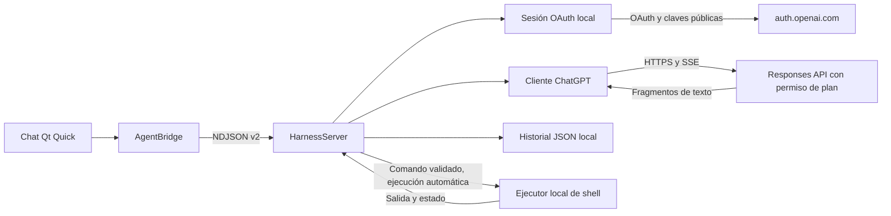

# Arquitectura del chat

Agent Shell mantiene su propia sesión de ChatGPT y conecta directamente con
OpenAI. Quickshell inicia únicamente el backend Python; no hay proceso de Codex.

## Responsabilidades

- `ChatWindow`: chat, cuenta, modelo, control de respuesta e historial.
- `WorkspaceSwitcher`: selector Chat | Work centrado sobre el contenido.
- `WorkProjects` y `ProjectDialog`: listado y registro de proyectos con una carpeta local.
- `AgentBridge`: aplica eventos, reconcilia texto final por identificador y abre
  la autorización sólo al solicitar el usuario iniciar sesión.
- `ChatCommands.js`: catálogo compartido, análisis y disponibilidad de comandos
  locales. `AgentBridge.submit` los resuelve antes del envío HTTP; `ChatWindow`
  abre sus paneles y `MessageComposer` ofrece sugerencias en la fila de envío,
  dentro de un espacio reservado de altura fija para evitar desplazar el chat.
  `/modelos` filtra modelos de la cuenta y confirma su selección localmente;
  el editor no incluye un selector de modelos adicional. `/shell comando` envía
  `shell.execute` para ejecutar directamente sin solicitar una respuesta de IA.
- `HarnessServer`: valida instrucciones, construye contexto local, coordina
  operaciones en trabajadores y emite el contrato NDJSON.
- `ChatGPTSession`: registro dinámico de cliente, callback loopback, validación
  de identidad, permisos, persistencia y renovación.
- `HttpClient`: HTTPS verificado sin redirecciones automáticas, errores sin
  diagnósticos privados, lectura SSE y cierre de sockets al cancelar.
- `ChatGPTClient`: descubre modelos de la cuenta y solicita respuestas.
- `ShellExecutor`: ejecuta automáticamente comandos validados, acota la salida y termina grupos de procesos.
- `context.py`: conserva elementos de Responses y cierra llamadas recuperadas sin reejecutarlas.
- `HistoryStore`: metadatos y mensajes en JSON atómico.
- `images.py`: valida imágenes y construye contenido multimodal de Responses.
- `clipboard.py`: lectura binaria acotada del portapapeles; Qt conserva miniaturas,
  adjuntos del borrador y correlación de solicitudes sin mezclar conversaciones.
- `ProjectExplorer`, `ProjectExplorerWindow` y `ProjectFileWindow`: lectura confinada de carpetas y texto,
  árbol y hasta dos visores de texto en ventanas independientes en Work, cada una con su
  propio sondeo mientras está visible; sin inferencia,
  escrituras ni atribución de cambios al modelo.
- `ProjectStore`: nombres y carpetas de proyectos de Work en JSON privado y atómico.
- `TurnPerformance`: reloj monotónico, etapas del turno, contexto de la última llamada,
  conteos acumulados y velocidad en tokens basada en uso reportado y tiempo HTTP por solicitud.
- `Performance.js`: formato de métricas y estadísticas por modelo en Qt.
- `EventEmitter`: secuencia global y escritura serializada entre trabajadores.

## Autenticación

Antes de autorizar se crea un host estable, `ext_agent_host_id`, independiente de
la identidad de usuario. El registro inicial usa `dynamic_agent_client`, nombre
`Agent Shell`, scopes de identidad y permiso `chatgpt.tokens.use.direct`.
Las reconexiones usan el cliente emitido por OpenAI, asociado a esa cuenta y
espacio de trabajo. **Usar otra cuenta** inicia un registro separado, sin enviar
el ID token de la cuenta anterior y manteniendo el mismo host.
Cada registro conserva su cliente, identidad y tokens: `connection` contiene la
cuenta activa y `saved_connections` las demás. Los archivos anteriores de una
sola cuenta siguen siendo válidos. La nueva identidad se verifica antes de
guardar o activar la cuenta; un fallo o cancelación conserva la cuenta anterior.
Un código caducado conserva el cliente emitido pendiente para reintentar el
intercambio mediante otra autorización, separado del registro activo.
El selector identifica cada registro mediante un hash del cliente, con una
etiqueta estable y correo para presentarlo; no agrupa registros por correo.
Cambiar de cuenta actualiza los modelos y conserva las conversaciones. Cerrar
sesión revoca y elimina únicamente los tokens de la cuenta seleccionada.

Cada intento tiene state, nonce y PKCE nuevos. El listener está ligado únicamente
a `127.0.0.1` y a `/auth/callback`. El intercambio usa exactamente el mismo URI,
incluyendo puerto. Un callback con state incorrecto no consume el intento válido.

Se verifica la firma RS256 del ID token con JWKS de OpenAI, emisor, audiencia,
vencimiento, nonce y sujeto. Una reautorización no puede sustituir la identidad de
la cuenta. Sólo el permiso concedido de plan habilita inferencia.

El archivo de sesión contiene el host, cliente, identidad verificada y tokens.
Las renovaciones se serializan con un bloqueo entre procesos, reemplazando tokens
rotativos atómicamente. Los ajustes de Codex nunca se leen ni se modifican.

## Inferencia y contexto

El catálogo viene de `GET https://api.openai.com/v1/models` con el token OAuth.
Se muestran entradas con `visibility: list`, se conserva su orden y se envía el
`slug` del modelo seleccionado. No hay un modelo de pago independiente como fallback.

Cada turno envía instrucciones y los mensajes locales mediante
`POST https://api.openai.com/v1/responses`, con `store: false` y `stream: true`.
La función `shell` se anuncia en todas las solicitudes. Tras recibir una llamada
completa y validada, el backend la guarda y ejecuta automáticamente, devolviendo
el resultado con su `call_id` para continuar. La IA confirma brevemente comandos
simples sin duplicar la salida de la tarjeta, o interpreta los resultados cuando
la tarea requiere análisis. `/shell` utiliza el mismo ejecutor sin inferencia;
sus resultados se conservan localmente y no entran en el contexto del modelo.
Los fragmentos y el texto final se reconcilian por
item y parte de contenido. Sólo `response.completed` con estado confirmado
marca el final de una solicitud al modelo. Si contiene herramientas, el turno
continúa hasta la respuesta final o un límite, rechazo o cancelación.
Fallos, respuestas incompletas y cortes de conexión conservan el texto
parcial y liberan los controles.

Los JSON de 0.2.0 siguen siendo legibles. Su antiguo thread_id no se consulta:
continuar utiliza los mensajes locales. Si faltaba contexto interno, no puede
reconstruirse. Las conversaciones demasiado largas pueden superar el contexto;
todavía no hay compactación.

## Persistencia y ciclo de vida

Los chats antiguos pertenecen al área Chat. Los nuevos registros añaden `area`
y `project_id` sin cambiar el esquema 1. `HarnessServer` filtra el historial por
estos campos y mantiene una conversación abierta por área/proyecto durante la
sesión. Cambiar restaura esa conversación y el directorio; `MessageComposer`
conserva un borrador por espacio en memoria. Los proyectos se registran en
`projects/`, bajo el directorio del historial, y permanecen después de reiniciar.
Sus conversaciones se recuperan desde el historial correspondiente.

Work usa instrucciones orientadas a inspección, implementación y comprobación
de proyectos. Chat prioriza conversación general. Ambos utilizan el mismo cliente,
cuenta y ejecutor shell; la selección no hace solicitudes a OpenAI. Los comandos
de Work usan su carpeta persistida y no la carpeta de Chat. Una respuesta, ejecución
u operación de cuenta en curso bloquea el cambio para conservar el contexto activo.

Las mediciones se guardan en el array opcional `performance` del chat. Un `turn_id`
vincula mensajes y medición; una generación evita actualizaciones de turnos cancelados.
`StreamControl` informa inicio/fin de sesión, solicitud HTTP y cabeceras al servidor.
Qt confirma la aproximación de presentación del primer texto con `frameSwapped`.
Los eventos de rendimiento durante streaming se agrupan cada 250 ms sin añadir
escrituras por fragmento. El panel consulta como máximo 200 turnos de archivos locales.
Las definiciones y límites se describen en [rendimiento](performance.md).

El primer mensaje o comando directo crea el chat y se guarda antes de inferencia
o ejecución. El
streaming actualiza Qt antes del guardado y agrupa escrituras cada medio segundo.
Al terminar, cancelar o recibir SIGTERM se guarda el estado final y el texto pendiente.

Cancelar cierra el socket de streaming y marca inmediatamente el turno como
interrumpido, terminando también el grupo de shell activo.
Una generación impide que eventos tardíos contaminen el siguiente
turno. El backend sigue disponible después de errores de red para reintentar.
Cerrar stdin o SIGTERM cancela operaciones; los trabajadores de red tienen timeout.

El historial está separado de las credenciales. Puede leerse sin autenticación,
durante el descubrimiento del catálogo y si el archivo de sesión es incompatible.
La prueba Qt usa un backend real con cuenta de prueba y servicio HTTP local.
El usuario confirmó la autenticación real desde el escritorio. También se verificó
una respuesta real con el backend y la sesión propia de Agent Shell, hasta recibir
texto y `response.completed`.
En `0.7.0`, la integración de shell también se comprobó con la sesión real: solicitud de
`pwd`, ejecución aprobada en una carpeta temporal y respuesta basada en su salida,
seguida de continuación desde ese contexto con la terminal desactivada.

La posición inicial del árbol y los dos visores en Hyprland se aplica con
`scripts/place-text-viewer.py`: espera acotada al mapeo, selección por PID y título
y operaciones por dirección de ventana. Las carpetas quedan arriba a la izquierda,
el visor 1 alto a la derecha y el 2 abajo a la izquierda, en coordenadas lógicas
del monitor y descontando las
zonas reservadas. Sólo actúa en la apertura; no instala reglas globales ni impide
mover o redimensionar las ventanas. Detecta la versión para usar dispatchers Lua
desde Hyprland 0.55 o las órdenes anteriores, siguiendo los
[dispatchers documentados](https://wiki.hypr.land/0.56.0/Configuring/Basics/Dispatchers/).
Otros compositores deciden la posición.

El árbol y los visores manejan la señal
[`closed()` de QsWindow](https://quickshell.org/docs/v0.3.0/types/Quickshell/QsWindow/#sig.closed)
asignando `visible = false`. Esto sincroniza la intención interna de apertura
tras un cierre del compositor, cancela las lecturas pendientes y permite volver
a mostrar la misma ventana; cerrar con el botón de la aplicación también la oculta.
