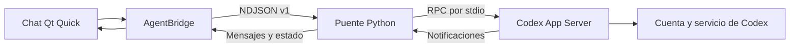

# Arquitectura del chat

## Objetivo

Construir una interfaz propia con Quickshell sobre el motor de Codex y la cuenta
ChatGPT que el usuario ya usa en la CLI. La aplicación actual se concentra en
conversar; las herramientas visuales de programación se decidirán después.

## Responsabilidades

- `ChatWindow`: cuenta visible, formulario, conversación y controles.
- `AgentBridge`: aplica deltas, reemplaza el texto final por id de mensaje y mantiene
  el estado que habilita los controles. Abre la URL OAuth cuando el usuario inicia sesión.
- `HarnessServer`: valida instrucciones, consulta cuenta, crea threads y turnos,
  traduce eventos y tramita la interrupción de una respuesta.
- `CodexClient`: proceso hijo, handshake, ids RPC, respuestas concurrentes, notificaciones
  y cierre del transporte. No lee archivos de autenticación ni implementa OAuth.
- `EventEmitter`: serializa los eventos de la interfaz para varios hilos.
- `HistoryStore`: un JSON por conversación, escritura atómica y recuperación local.

## Flujo

1. Python inicia `codex app-server --stdio` y envía `initialize` con identidad y versión
   de Agent Shell. Después envía la notificación `initialized`.
2. `account/read` consulta la cuenta administrada por Codex. Sólo `type: chatgpt`
   habilita el chat. Se muestran únicamente correo, plan y estado.
3. El primer mensaje crea un thread persistente con un directorio de contexto vacío,
   proveedor OpenAI, sandbox `read-only`, shell y conectores desactivados, búsqueda
   web desactivada e instrucciones para conversar.
4. Cada mensaje inicia `turn/start` en el mismo thread. `item/agentMessage/delta`
   amplía el mensaje correspondiente; `item/completed` reconcilia su texto final.
5. `turn/completed` libera los controles con resultado completado, fallido o interrumpido.
   Se verifica el estado final, no se trata cualquier evento de cierre como éxito.
6. Detener invoca `turn/interrupt`. Si aún no existe turno, se recuerda la cancelación
   para no perderla durante la creación del thread o el inicio del turno.

Las llamadas RPC esperan en trabajadores. El hilo lector sigue entregando deltas,
respuestas y peticiones del servidor. Una generación evita que una respuesta RPC
tardía del turno anterior cambie el estado de uno nuevo.

## Autenticación

Al pulsar Iniciar sesión se solicita `account/login/start` de tipo `chatgpt`. Se
valida una URL HTTPS de `auth.openai.com` antes de enviarla a Qt. App Server gestiona
callback, tokens y almacenamiento. La aplicación espera `account/login/completed`
y vuelve a consultar la cuenta. Cancelar usa `account/login/cancel`.

La sesión pertenece a Codex y puede compartirse con la CLI. Agent Shell no almacena
contraseñas, access tokens ni refresh tokens. Tampoco importa conversaciones de
ChatGPT. Los eventos de razonamiento y diagnósticos crudos del App Server no se
reenvían a la interfaz.

## Ciclo de vida y límites

El historial local vive en `.runtime/chats/`, separado de `.runtime/chat/`, el
directorio de contexto. Al aceptar un mensaje se crea su conversación y se guarda el
texto. Cada delta amplía el JSON; el mensaje final reemplaza los fragmentos por id.
Un temporal con permisos 0600 se vacía a disco y se reemplaza mediante `os.replace`.
Así una escritura interrumpida conserva un JSON completo anterior o posterior.

Los threads de Codex se crean con `ephemeral: false`. Abrir un historial carga los
mensajes locales sin depender del motor; al enviar otra solicitud se usa `thread/resume`
con las mismas opciones de conversación. Si el thread falta, se conserva el archivo
local y se informa el error, sin reemplazarlo por un contexto nuevo silenciosamente.
Nuevo chat desacopla la conversación actual sin borrar sus archivos. El arranque
publica la ubicación y lista del historial antes de conectar con Codex, de modo que
los mensajes siguen siendo consultables cuando App Server no está disponible.

Cerrar stdin o recibir SIGTERM cierra también el proceso de Codex. Si éste desaparece,
se desbloquean llamadas pendientes y el chat muestra desconexión; se debe relanzar.
Las respuestas parciales conservan su texto y quedan marcadas como interrumpidas.
El lanzador evita iniciar otra instancia del mismo shell con `--no-duplicate`.

No hay implementación de herramientas propias, editor ni terminal. Las solicitudes
RPC de aprobación se rechazan y otras peticiones interactivas no soportadas reciben
un error de método. La política del thread limita escrituras de herramientas del
agente; no sustituye las políticas de servicios externos o la configuración gestionada
de Codex. Esta versión no es una implementación genérica de permisos de agentes.

La prueba Qt usa un doble de Codex seleccionado explícitamente. Comprueba nuestra
integración, pero no garantiza login ni inferencia real. El arranque real en el entorno
de desarrollo está limitado por el directorio de Codex de sólo lectura.
