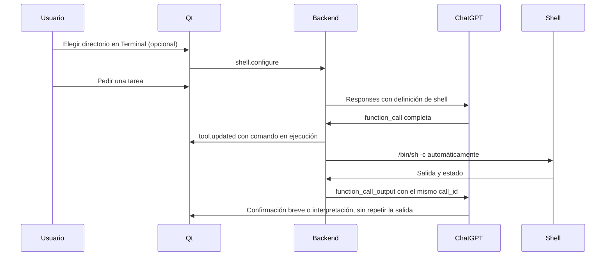

# Integración de shell

[← Índice de documentación](../README.md)

La implementación adapta [GUIA-LLM-TERMINAL.md](GUIA-LLM-TERMINAL.md) al backend
Python de Agent Shell. OpenCode sirve como referencia de arquitectura; la aplicación
conserva su sesión propia de ChatGPT y no depende de OpenCode ni de Codex.

## Ejecución directa desde el chat

Escribe `/shell pwd`, `/shell ls -la` o `/shell git status` para ejecutar sin IA.
Qt valida el comando y envía `shell.execute`; Python usa el mismo ejecutor local
de la herramienta, sin solicitar una respuesta a ChatGPT. Funciona sin sesión
ni catálogo de modelos y no crea mediciones de rendimiento de IA.

Completar `/shell` prepara un espacio para escribir el argumento. Las sugerencias
se ocultan al empezar la orden; comillas, tuberías y saltos de línea se conservan.
El comando admite entre 1 y 8000 caracteres, sin NUL. Un argumento vacío muestra
un aviso y conserva el borrador.

La tarjeta **Terminal local** muestra comando, directorio, salida, estado y código
de salida. El comando encabeza la tarjeta junto al estado y la duración real,
cuando está disponible; los códigos distintos de cero quedan visibles y el código
completo se puede consultar al pasar el cursor por el estado. El directorio se
abrevia y muestra su ruta completa al pasar el cursor. Las salidas largas presentan
ocho líneas y hasta 1600 caracteres, con **Ver salida completa** para ampliar la
tarjeta dentro del chat y **Ver menos** para reducirla. Copiar conserva toda la
salida guardada, incluso desde la vista compacta. Un resultado vacío indica
**Sin salida**; el recorte del ejecutor se diferencia de esta vista previa.
Si sudo informa que necesita una terminal para pedir la contraseña, la tarjeta
aclara esa limitación sin interpretar ni modificar la salida original.
Se guarda en `tool_calls` con `source: local`, sin mensajes de usuario
o IA ni incorporación al contexto del modelo. **Detener** o `/detener` conserva
la salida parcial y termina el grupo del proceso. Abrir el historial no reejecuta.
Una respuesta de IA, ejecución local u operación de cuenta bloquea nuevos envíos.

Cada comando tiene su proceso y empieza en el directorio configurado. `cd` no
persiste entre envíos; usa `/terminal` para cambiar el directorio o combina
órdenes en el mismo envío, como `/shell cd carpeta && pwd`.

## Fronteras de ejecución

La terminal está siempre disponible y es una función principal. `ChatGPTClient`
anuncia una función `shell` con un único argumento `command` en todas las respuestas.
La IA la usa cuando necesita trabajar con el sistema local; puede conversar sin
ejecutar comandos. Todos los comandos se permiten, sin lista de autorizaciones
ni confirmaciones por ejecución.
Las instrucciones del agente y la descripción de la herramienta indican que la
salida ya aparece en la tarjeta. Para una petición simple como `pwd`, la respuesta
debe confirmar brevemente la ejecución, por ejemplo «El comando se ejecutó
correctamente», sólo con estado `completed` y código 0. Ante errores, timeout o
interrupciones debe comunicar el resultado real sin copiar la salida. En tareas
de análisis puede explicar conclusiones y siguientes pasos sin transcribir rutas,
listados o logs. Esta pauta se envía al modelo en todas las llamadas del turno.
La solicitud usa `store: false`, streaming, esquema estricto y
`parallel_tool_calls: false`. Aun así, el backend valida las llamadas y procesa
secuencialmente cualquier lote recibido. No interpreta órdenes de texto libre
ni de bloques Markdown. Espera siempre una respuesta completada; los fragmentos
de argumentos no provocan ejecución. Si el resumen final trae `output` vacío,
reconstruye los elementos completos recibidos en `response.output_item.done`,
conservando su orden. Recibir ese evento sin `response.completed` tampoco ejecuta nada.

`shell.py` valida JSON, nombres de campos, longitud y caracteres NUL. El modelo
no puede escoger directorio ni timeout con argumentos adicionales. Un argumento
inválido o una herramienta desconocida produce
un resultado de error que permite al modelo corregir la solicitud.

Antes de ejecutar se guarda la llamada con estado `running`. Si falla esa escritura,
no se crea el proceso. El ejecutor recibe el comando validado y comprueba que el
turno siga activo antes de crear el proceso. Cambiar el directorio durante un turno
se rechaza. El protocolo v2 elimina `tool.decide` y los eventos de aprobación.

## Procesos y límites

La ejecución utiliza `/bin/sh -c` con stdin cerrado y stdout/stderr combinados.
El entorno conserva una selección de variables de la sesión del usuario: `PATH`,
idioma, `HOME`, directorios XDG, conexión Wayland/X11, autorización X11, D-Bus y
configuración de Qt, entrada de texto y compositor. Así, los programas gráficos
pueden conectarse al mismo escritorio que Agent Shell. No inventa valores de
`DISPLAY`, `WAYLAND_DISPLAY` ni permisos: una sesión ausente o inaccesible sigue
produciendo un error. No hereda variables arbitrarias del backend ni claves de
API; `TERM=dumb` conserva la salida no interactiva. No inicia un perfil de login;
las herramientas instaladas sólo en perfiles interactivos pueden necesitar rutas explícitas.

El timeout es de 120 segundos y la salida se limita a 16000 caracteres Unicode.
La salida adicional se drena sin almacenarla; un indicador señala el recorte.
Los fragmentos UTF-8 se decodifican de forma incremental y se publican como texto
plano, con actualizaciones agrupadas cada 250 ms.

El botón **Ejecutar** de Work utiliza `ProjectRunner`, separado del turno de chat.
En la primera ejecución, el backend adelanta una lectura acotada de manifiestos,
instrucciones y puntos de entrada. La IA utiliza ese contexto, solicita comandos
acotados de `shell` si faltan datos o preparación, y elige un
único comando final con `launch_program`. Este programa se ejecuta en primer plano
sin timeout, con el mismo entorno y límite de salida; **Detener** y cerrar Agent
Shell terminan su grupo. La ausencia de un comando de inicio o un fallo real se
informa en la cabecera de Work. El contexto, instrucciones, respuesta y comandos
de detección sólo viven en memoria: no se guardan ni aparecen en el chat.
El comando final sí se guarda en el registro privado del proyecto cuando sale
con código cero o continúa vivo un segundo. Las siguientes ejecuciones comprueban
la configuración y reutilizan la orden sin IA, incluso después de reiniciar y sin
sesión de ChatGPT. Editar fuentes conserva el inicio; cambiar scripts/manifiestos,
permisos o quitar puntos de entrada lo invalida. Un fallo de la orden guardada
permite una nueva detección con la salida real, si hay conexión a ChatGPT.
Sobrevivir un segundo no verifica que una aplicación ya esté lista para usarse.
Las ventanas gráficas y servidores pueden seguir activos mientras se conversa;
el programa no se convierte en un job de shell ni se separa de la aplicación.

Cada proceso se crea en un grupo propio. **Detener**, timeout y cierre normal
terminan el grupo con SIGKILL. No se gestionan PTY, entrada interactiva ni jobs de
fondo; los descendientes del grupo se terminan al salir la orden principal.
Un programa que cree otra sesión puede escapar del grupo. Un cierre forzado del
backend también puede dejar procesos vivos: esta función no es una sandbox.

El directorio elegido no restringe rutas absolutas ni impide cambiar de carpeta
desde un comando. Los comandos se ejecutan con los permisos del usuario de la
aplicación. La salida de la herramienta pedida por la IA entra en su contexto;
la salida de `/shell` permanece en el historial local.

El bucle admite hasta ocho solicitudes al modelo y ocho comandos por turno.
La última solicitud debe finalizar la respuesta; si vuelve a pedir herramientas,
el turno termina por límite sin ejecutar esas nuevas llamadas.

## Historial y continuación

El JSON conserva los mensajes visibles, `tool_calls` y un `context` opcional con
los elementos de Responses. Llamadas y resultados conservan el mismo `call_id`;
los mensajes conservan `phase`. Los elementos de razonamiento se conservan como
contenido cifrado y no se publican a Qt; el razonamiento en texto no se almacena.
Esto permite continuar con `store: false`, sin threads remotos. La conexión sigue
la [documentación de llamadas a funciones](https://developers.openai.com/api/docs/guides/function-calling)
y de [contexto de Responses](https://developers.openai.com/api/docs/guides/conversation-state).

Los chats anteriores se convierten desde sus mensajes al continuar la conversación.
Recuperar una llamada pendiente o en ejecución la muestra como interrumpida y
completa su resultado de contexto con ese estado. Nunca se reejecuta al abrir el
chat. No se garantiza conocer el efecto final de una orden tras un cierre forzado.

La terminal permanece disponible tras reiniciar; el directorio inicial viene de
`AGENT_SHELL_WORKSPACE` / `--workspace` o del directorio del backend. El directorio
elegido desde Qt dura hasta cerrar la aplicación.

## Validación

Las pruebas ejercitan procesos locales en carpetas temporales: salida, Unicode,
códigos de error, límite, timeout, cancelación de descendientes y entorno de escritorio filtrado.
El servicio HTTP local solicita llamadas estructuradas para verificar ejecución
automática, cambios de archivos, pipelines, argumentos inválidos, persistencia,
continuación y límites del bucle.
La prueba Qt recorre un comando `pwd` real, tarjetas e historial. Estas pruebas
no validan por sí mismas la disponibilidad de herramientas en una cuenta real.
Las pruebas de `/shell` comprueban ejecución sin autenticación ni peticiones al
proveedor, conservación del contexto de IA, argumentos, errores, cancelación,
timeout, persistencia previa y restauración. Su escenario Qt ejercita el envío
desde el editor, el completado sin ejecución y las tarjetas de salida.

El 2026-10-11 se comprobó también el ciclo con la sesión real de Agent Shell y
`gpt-6.1-sol`: petición estructurada de `pwd`, aprobación limitada a esa orden en
una carpeta temporal, ejecución local y respuesta del modelo con la salida real.
Una segunda petición, con Terminal desactivada, recuperó el mismo directorio del
contexto. Este stream entregó los elementos en `output_item.done` y dejó vacío
el `output` de `response.completed`; hay pruebas de regresión para ese formato.
