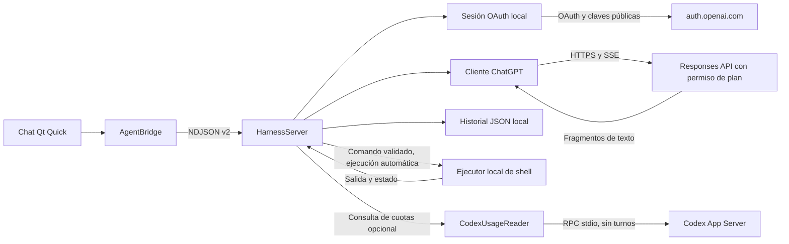

# Arquitectura del chat

[← Índice de documentación](../README.md)

Agent Shell mantiene su propia sesión de ChatGPT y conecta directamente con
OpenAI. Quickshell inicia el backend Python. Sólo al consultar cuotas, Python
abre un proceso transitorio de Codex App Server; el chat y shell siguen siendo propios.

## Responsabilidades

El backend conserva `backend/main.py` como entrada. Los módulos de `backend/harness/`
se agrupan por responsabilidad; cada carpeta es un paquete Python:

- `account/`: sesión, OAuth y consulta de cuotas.
- `chat/`: cliente ChatGPT, modelos, contexto, historial, imágenes y métricas.
- `core/`: servidor, eventos, HTTP y lectura de la versión.
- `tools/`: comandos de shell y acceso al portapapeles.
- `work/`: registro de proyectos, exploración, actividad de archivos y ejecución.

Las piezas principales del backend y la interfaz tienen estas responsabilidades:

- `ChatWindow`: chat, cuenta, modelo, control de respuesta e historial.
- `ui/components/`: componentes QML agrupados por chat, Work, ventanas, diálogos y piezas compartidas; `ui/js/` contiene la lógica de interfaz en JavaScript.
- `WorkspaceSwitcher`: selector Chat | Work centrado sobre el contenido.
- `WorkProjects` y `ProjectDialog`: listado y registro de proyectos con una carpeta local.
- `AgentBridge`: aplica eventos, reconcilia texto final por identificador y abre
  la autorización sólo al solicitar el usuario iniciar sesión.
- `ui/js/ChatCommands.js`: catálogo compartido, análisis y disponibilidad de comandos
  locales. `AgentBridge.submit` los resuelve antes del envío HTTP; `ChatWindow`
  abre sus paneles y `MessageComposer` ofrece sugerencias en la fila de envío,
  dentro de un espacio reservado de altura fija para evitar desplazar el chat.
  `/modelos` organiza familias → modelos → esfuerzos y confirma la selección localmente;
  el editor no incluye un selector de modelos adicional. `/shell comando` envía
  `shell.execute` para ejecutar directamente sin solicitar una respuesta de IA.
- `HarnessServer`: valida instrucciones, construye contexto local, coordina
  operaciones en trabajadores y emite el contrato NDJSON.
- `ChatGPTSession`: registro dinámico de cliente, callback loopback, validación
  de identidad, permisos, persistencia y renovación.
- `HttpClient`: HTTPS verificado sin redirecciones automáticas, errores sin
  diagnósticos privados, lectura SSE y cierre de sockets al cancelar.
- `ChatGPTClient`: descubre modelos de la cuenta y solicita respuestas.
- `models.py`: agrupa slugs por generación y normaliza compatibilidad de esfuerzo;
  usa los niveles anunciados por el catálogo (`supported_reasoning_levels` o
  `supported_reasoning_efforts`) antes de la tabla limitada de modelos documentados.
  Un slug desconocido sin datos conserva el valor predeterminado del servidor.
  No añade modelos que la cuenta no haya anunciado.
- `ShellExecutor`: ejecuta automáticamente comandos validados, acota la salida y termina grupos de procesos.
- `ProjectRunner`: tarea interna para inspeccionar un proyecto con el modelo
  seleccionado e iniciarlo mediante `launch_program`, sin mensajes ni persistencia
  de chat. Mantiene control HTTP/shell independiente del turno conversacional.
- `context.py`: conserva elementos de Responses y cierra llamadas recuperadas sin reejecutarlas.
- `core/limits.py`: presupuestos configurables por turno y detección de fallos idénticos consecutivos.
- `tools/output.py`: captura limitada con inicio/final y vista reducida de resultados para el modelo.
- `HistoryStore`: metadatos y mensajes en JSON atómico.
- `images.py`: valida imágenes y construye contenido multimodal de Responses.
- `clipboard.py`: lectura binaria acotada del portapapeles; Qt conserva miniaturas,
  adjuntos del borrador y correlación de solicitudes sin mezclar conversaciones.
- `ProjectExplorer`, `ProjectExplorerWindow` y `ProjectFileWindow`: lectura confinada de carpetas y texto,
  árbol y hasta dos visores de texto en ventanas independientes en Work, cada una con su
  propio sondeo mientras está visible; sin inferencia,
  escrituras ni atribución de cambios al modelo.
- `ProjectStore`: nombres y carpetas de proyectos de Work en JSON privado y atómico.
- `TurnPerformance`: reloj monotónico, etapas del turno, contexto de la última llamada,
  conteos acumulados y velocidad en tokens basada en uso reportado y tiempo HTTP por solicitud.
- `ui/js/Performance.js`: formato de métricas y estadísticas por modelo en Qt.
- `EventEmitter`: secuencia global y escritura serializada entre trabajadores.

## Autenticación

### Cuotas mediante Codex

`CodexUsageReader` inicia `codex app-server --listen stdio://` fuera del proyecto
y usa los métodos oficiales `initialize`, `account/read`, `account/rateLimits/read`
y, cuando se admite, `account/usage/read`. No crea hilos ni turnos de inferencia,
no copia tokens, no importa historiales y no inicia/cierra sesiones de Codex.
Codex administra su propia autenticación y renovación. La consulta exige una
sesión ChatGPT y que su correo coincida con el de Agent Shell; no verifica el
espacio de trabajo de la conexión SIWC. La fuente mostrada es siempre Codex.

El trabajador de cuotas tiene estado propio, no bloquea respuestas/shell y admite
una consulta a la vez. Se invalida la instantánea si cambia la cuenta activa;
Qt descarta resultados tardíos por `request_id`. Las ventanas de cuota se toman
del servicio, sin asumir que duren cinco horas o una semana. Porcentaje cero,
datos desconocidos y créditos ilimitados son estados distintos. Los tokens del
resumen de Codex no son una estimación de cuota ni de consumo global de ChatGPT.

El transporte usa lectura sin buffering y separa líneas antes de esperar de nuevo
en el selector. Tiene plazo total de 20 segundos, resumen opcional de 3 segundos,
límites de 2 MiB por acumulación y 8 MiB por consulta, mensajes de error locales
sin propagar contenido remoto y cierre del proceso en éxito, error o cierre del
backend. `AccountUsageWindow` consulta al abrir y cada minuto visible; conserva
el aspecto mate monocromático. Es una tarjeta de 320 píxeles de ancho con altura
adaptativa (140–420), con límites de altura que también ajustan la ventana nativa
cuando llegan las cuotas en Wayland, sin cabecera, botones, identidad, créditos, totales históricos
ni pie de actualización visibles. Los nombres sólo aparecen si hay más de una
categoría de cuotas; las ventanas ausentes no crean filas adicionales, conservando
«Sin datos» si no se informa ninguna. El arrastre se inicia con `DragHandler`
desde la tarjeta; Esc cierra y F5 actualiza mediante atajos limitados a su ventana.
Es un `FloatingWindow` independiente de Chat. No participa en `dialogVisible` ni en el desenfoque/modalidad
del chat. Cambiar de área conserva la ventana; cerrar pausa el temporizador y
`onClosed` sincroniza la intención de visibilidad para permitir reapertura tras
cierre nativo. Abrir una ventana ya visible la reutiliza y la activa.
La cifra y la barra principales muestran `100 - used_percent` disponible para
facilitar la comparación con la web; el consumo permanece en el tooltip. Una
ventana desconocida conserva «Sin datos» y una barra vacía. La renovación se
calcula desde `resets_at`, con fecha local española en el tooltip. El resumen
histórico opcional sigue disponible en el protocolo, sin mostrarse en la tarjeta.

Las pruebas inyectan un servidor RPC de Python y nunca arrancan Codex real. Se
validó además el adaptador con Codex instalado y la sesión real del usuario:
cuenta coincidente, dos ventanas con porcentaje informado y resumen disponible.

Antes de autorizar se crea un host estable, `ext_agent_host_id`, independiente de
la identidad de usuario. El registro inicial usa `dynamic_agent_client`, nombre
`Agent Shell`, scopes de identidad y permiso `chatgpt.tokens.use.direct`.
Las reconexiones usan el cliente emitido por OpenAI, asociado a esa cuenta y
espacio de trabajo. **Usar otra cuenta** inicia un registro separado, sin enviar
el ID token de la cuenta anterior y manteniendo el mismo host.
Cada registro conserva su cliente, identidad y tokens: `connection` contiene la
cuenta activa y `saved_connections` las demás. Los archivos anteriores de una
sola cuenta siguen siendo válidos. La nueva identidad se verifica antes de
guardar o activar la cuenta; un fallo o cancelación conserva la cuenta anterior.
Un código caducado conserva el cliente emitido pendiente para reintentar el
intercambio mediante otra autorización, separado del registro activo.
El selector identifica cada registro mediante un hash del cliente, con una
etiqueta estable y correo para presentarlo; no agrupa registros por correo.
Cambiar de cuenta actualiza los modelos y conserva las conversaciones. Cerrar
sesión revoca y elimina únicamente los tokens de la cuenta seleccionada.

Cada intento tiene state, nonce y PKCE nuevos. El listener está ligado únicamente
a `127.0.0.1` y a `/auth/callback`. El intercambio usa exactamente el mismo URI,
incluyendo puerto. Un callback con state incorrecto no consume el intento válido.

Se verifica la firma RS256 del ID token con JWKS de OpenAI, emisor, audiencia,
vencimiento, nonce y sujeto. Una reautorización no puede sustituir la identidad de
la cuenta. Sólo el permiso concedido de plan habilita inferencia.

El archivo de sesión contiene el host, cliente, identidad verificada y tokens.
Las renovaciones se serializan con un bloqueo entre procesos, reemplazando tokens
rotativos atómicamente. El cliente de chat no lee ni modifica ajustes de Codex;
el proceso opcional de cuotas administra su propia sesión y configuración.

## Inferencia y contexto

El catálogo viene de `GET https://api.openai.com/v1/models` con el token OAuth.
Se muestran entradas con `visibility: list`, se conserva su orden y se envía el
`slug` del modelo seleccionado. No hay un modelo de pago independiente como fallback.

Cada turno envía instrucciones y los mensajes locales mediante
`POST https://api.openai.com/v1/responses`, con `store: false` y `stream: true`.
La función `shell` se anuncia en todas las solicitudes. Tras recibir una llamada
completa y validada, el backend la guarda y ejecuta automáticamente, devolviendo
el resultado con su `call_id` para continuar. La IA confirma brevemente comandos
simples sin duplicar la salida de la tarjeta, o interpreta los resultados cuando
la tarea requiere análisis. `/shell` utiliza el mismo ejecutor sin inferencia;
sus resultados se conservan localmente y no entran en el contexto del modelo.
Los fragmentos y el texto final se reconcilian por
item y parte de contenido. Sólo `response.completed` con estado confirmado
marca el final de una solicitud al modelo. Si contiene herramientas, el turno
continúa hasta la respuesta final o un límite, rechazo o cancelación. Un mensaje
marcado como comentario intermedio también provoca continuación; una respuesta
sin texto ni herramientas produce un error. Los presupuestos predeterminados
son 32 solicitudes, 64 herramientas y 300 segundos por comando de la IA. Los
resultados nuevos se recortan una sola vez a 6000 caracteres de salida para el
modelo, conservando inicio/final, estado y código; la tarjeta retiene hasta
16000 caracteres. La conexión HTTP se cierra antes de trabajar en la shell.
Fallos, respuestas incompletas y cortes de conexión conservan el texto
parcial y liberan los controles.

Los JSON de 0.2.0 siguen siendo legibles. Su antiguo thread_id no se consulta:
continuar utiliza los mensajes locales. Si faltaba contexto interno, no puede
reconstruirse. Las conversaciones demasiado largas pueden superar el contexto;
todavía no hay compactación.
La [auditoría de continuidad y consumo](harness-audit.md) documenta los cambios,
las regresiones y el trabajo pendiente; la [guía de prácticas](../guides/llm-practices.md)
describe los presupuestos configurables y cómo evaluar sus efectos.

## Persistencia y ciclo de vida

La conversación conserva `reasoning_effort` como metadato opcional del esquema 1.
Una selección válida se guarda antes de cambiar el estado; un fallo de escritura
conserva modelo, esfuerzo y conversación anteriores. Al reabrir se restaura sólo
un nivel aún compatible; si falta o deja de estar disponible, usa Auto. Un modelo
guardado que ya no está disponible tampoco hereda el esfuerzo de otro chat. La selección
sin conversación abierta permanece en memoria hasta crear una conversación.
Cada turno captura modelo y esfuerzo y mantiene ambos en todas sus llamadas de
herramientas. `ChatGPTClient` añade `reasoning: {effort: …}` sólo cuando el nivel
es explícito; Auto conserva las solicitudes anteriores sin ese campo. No se
modifica el contexto de mensajes ni se añade un comando al historial por elegirlo.
La compatibilidad de respaldo procede de la [guía de razonamiento de OpenAI](https://developers.openai.com/api/docs/guides/reasoning)
y las páginas oficiales de los modelos, no de una dependencia del CLI Codex.

`project.run` captura el identificador del proyecto, su carpeta y modelo, valida
ausencia de otra ejecución, y reserva un `execution_id`. `LaunchCache` compara
el inicio persistido con una lectura local antes de consultar al modelo. Si sigue
vigente, lanza la orden sin IA ni autenticación. Para detectar necesita sesión y
modelo disponibles. El trabajador realiza hasta ocho solicitudes/comandos con contexto efímero. Sólo
ejecuta herramientas después de `response.completed` confirmado; valida argumentos
e identificadores, conserva resultados y razonamiento cifrado únicamente en memoria.
`launch_program` inicia un proceso en primer plano sin timeout mediante el mismo
ejecutor y entorno de escritorio. `project.run.state` publica fases, comando,
salida acotada y resultado para la cabecera de Work; nunca emite eventos de chat,
herramientas conversacionales o rendimiento, ni crea una conversación.

`launch_profile` es un campo opcional del registro privado del proyecto, con
versión propia 1, carpeta, comando, huella SHA-256, rutas observadas y fecha de
validación. El guardado es atómico; una actualización de caché no puede revertir
un cambio de carpeta concurrente. Cambiar de carpeta elimina el perfil. La interfaz
recibe sólo `has_launch_profile` y eventos `project.run.cache`, sin el perfil completo.
El comando se guarda al terminar con código cero o sobrevivir un segundo; no es
una prueba de disponibilidad del servicio. Detener antes de validar no lo guarda;
un fallo posterior lo invalida. Un inicio guardado fallido permite una nueva
detección, una sola vez, con su salida real en el contexto interno.

`project_snapshot` observa manifiestos, locks, instrucciones, README y scripts
de inicio raíz, los scripts `scripts/{run,start,dev}.sh` y archivos locales citados
literalmente por la orden. Compara contenido y permisos de configuración/scripts;
en fuentes compara presencia y permisos, conservando la orden al editar código.
No añade logs generados a la huella. La lectura no recorre directorios: hasta
256 entradas raíz, 64 archivos, 1 MiB por archivo y 8 MiB totales. Exceder los
límites de comprobación desactiva el guardado. El contexto previo contiene hasta
4 KiB por archivo y 32 KiB totales; excluye `.env`, binarios, enlaces y rutas
fuera del proyecto. Los archivos referenciados mediante variables o subcomandos
de shell no se resuelven automáticamente; un fallo de inicio fuerza la revisión.

Chat y cambios de área siguen disponibles. El proceso y su carpeta se conservan
por proyecto hasta finalizar o detenerlo; los eventos se asocian al identificador
capturado, y las actualizaciones de trabajadores antiguos se descartan. No se
puede eliminar el proyecto mientras está activo. El cambio de cuenta se bloquea
durante la detección; una vez iniciado el programa no hay solicitudes de IA pendientes.
Detener cancela HTTP y el grupo de procesos propio, sin cancelar una respuesta
de chat simultánea; cerrar el backend también cancela el ejecutor del proyecto.
La cabecera contiene Ejecutar/Detener y Proyectos; los visores conservan su apertura
automática durante el trabajo normal de la IA, sin botones manuales de exploración.

Los chats antiguos pertenecen al área Chat. Los nuevos registros añaden `area`
y `project_id` sin cambiar el esquema 1. `HarnessServer` filtra el historial por
estos campos y mantiene una conversación abierta por área/proyecto durante la
sesión. Cambiar restaura esa conversación y el directorio; `MessageComposer`
conserva un borrador por espacio en memoria. Los proyectos se registran en
`projects/`, bajo el directorio del historial, y permanecen después de reiniciar.
Sus conversaciones se recuperan desde el historial correspondiente.

Eliminar un proyecto retira únicamente su registro y los historiales válidos de
Work asociados. El servidor valida las rutas privadas y aparta sus JSON en una
carpeta temporal privada; un fallo de traslado restaura lo ya movido. Si falla
también la restauración, conserva los archivos apartados para recuperación.
No es una transacción resistente a interrupciones del proceso; los JSON dañados
o enlaces simbólicos no se atribuyen a un proyecto y se conservan. La carpeta de
código nunca se recorre ni se borra. Se limpia la referencia al último proyecto,
su contexto en memoria y, mediante `project.deleted`, sus borradores y adjuntos
en Qt. El proyecto activo vuelve a la lista de Work; los demás espacios se conservan.

Work usa instrucciones orientadas a inspección, implementación y comprobación
de proyectos. Chat prioriza conversación general. Ambos utilizan el mismo cliente,
cuenta y ejecutor shell; la selección no hace solicitudes a OpenAI. Los comandos
de Work usan su carpeta persistida y no la carpeta de Chat. Una respuesta, ejecución
u operación de cuenta en curso bloquea el cambio para conservar el contexto activo.

Las mediciones se guardan en el array opcional `performance` del chat. Un `turn_id`
vincula mensajes y medición; una generación evita actualizaciones de turnos cancelados.
`StreamControl` informa inicio/fin de sesión, solicitud HTTP y cabeceras al servidor.
Qt confirma la aproximación de presentación del primer texto con `frameSwapped`.
Los eventos de rendimiento durante streaming se agrupan cada 250 ms sin añadir
escrituras por fragmento. El panel consulta como máximo 200 turnos de archivos locales.
Las definiciones y límites se describen en [rendimiento](../guides/performance.md).

El primer mensaje o comando directo crea el chat y se guarda antes de inferencia
o ejecución. El
streaming actualiza Qt antes del guardado y agrupa escrituras cada medio segundo.
Al terminar, cancelar o recibir SIGTERM se guarda el estado final y el texto pendiente.

Cancelar cierra el socket de streaming y marca inmediatamente el turno como
interrumpido, terminando también el grupo de shell activo.
Una generación impide que eventos tardíos contaminen el siguiente
turno. El backend sigue disponible después de errores de red para reintentar.
Cerrar stdin o SIGTERM cancela operaciones; los trabajadores de red tienen timeout.

El historial está separado de las credenciales. Puede leerse sin autenticación,
durante el descubrimiento del catálogo y si el archivo de sesión es incompatible.
La prueba Qt usa un backend real con cuenta de prueba y servicio HTTP local.
Las pruebas Python se agrupan por área en `tests/backend/`; `tests/ui/` reúne
los escenarios QML y la disposición de ventanas. `tests/support/` contiene los
servicios locales, la captura de eventos, las sesiones de prueba y las rutas
compartidas. `scripts/check.sh` descubre los paquetes desde la raíz del proyecto
y `scripts/smoke.sh` ejecuta la interfaz sobre una copia temporal aislada.
El usuario confirmó la autenticación real desde el escritorio. También se verificó
una respuesta real con el backend y la sesión propia de Agent Shell, hasta recibir
texto y `response.completed`.
En `0.7.0`, la integración de shell también se comprobó con la sesión real: solicitud de
`pwd`, ejecución aprobada en una carpeta temporal y respuesta basada en su salida,
seguida de continuación desde ese contexto con la terminal desactivada.

La posición inicial del árbol y los dos visores en Hyprland se aplica con
`scripts/place-text-viewer.py`: espera acotada al mapeo, selección por PID y título
y operaciones por dirección de ventana. `ChatWindow` pasa su título actual al
explorador y los dos visores; el helper consulta sólo la ventana principal del
mismo proceso para tomar su monitor y escritorio virtual. Si el auxiliar aparece
en otro escritorio, lo traslada con `follow=false` (Lua) o
`movetoworkspacesilent` (versiones anteriores), sin activar el escritorio destino
ni activar ventanas ajenas. Los escritorios numerados usan su ID; los nombrados y especiales
usan su selector validado, incluidos los IDs negativos de Hyprland. Si falta la ventana principal o hay
una identidad ambigua, la espera termina sin actuar sobre otras ventanas.
La geometría descuenta escala, rotación y zonas reservadas del monitor. Con ancho
útil W, margen m y separación g de 20 píxeles lógicos, cada columna mide
floor((W − 2m − 2g) / 3). Las columnas laterales se anclan a los márgenes y la
central a round((W − ancho_columna) / 2): el sobrante de redondeo se reparte con
una diferencia máxima de un píxel. Las dos ventanas izquierdas tienen la misma
altura floor((H − 2m − g) / 2), alineadas con los bordes superior e inferior del
visor derecho. La tarjeta de uso ocupa la cabecera central con su altura nativa
actual; el chat ocupa el resto, o toda la columna cuando la tarjeta no está abierta.
Abrir el árbol coloca también el chat y la tarjeta de uso del mismo PID, si está
mapeada; abrir uso en Work coloca esa tarjeta y el chat. Una variación de altura
del contenido de uso actualiza la columna central con un temporizador de 120 ms.
Abrir o rotar archivos no recoloca el chat ni los otros visores. En Chat la tarjeta
no se coloca automáticamente y su ancho inicial sigue siendo 320 píxeles.
En pantallas donde los mínimos no caben,
se prioriza la legibilidad y se limita la geometría al área útil, con posible
superposición. Sólo actúa al abrir o al ajustar la altura de uso; no instala reglas globales ni impide
mover o redimensionar las ventanas. Detecta la versión para usar dispatchers Lua
desde Hyprland 0.55 o las órdenes anteriores, siguiendo los
[dispatchers documentados](https://wiki.hypr.land/0.56.0/Configuring/Basics/Dispatchers/).
Otros compositores deciden la posición.

El árbol y los visores manejan la señal
[`closed()` de QsWindow](https://quickshell.org/docs/v0.3.0/types/Quickshell/QsWindow/#sig.closed)
asignando `visible = false`. Esto sincroniza la intención interna de apertura
tras un cierre del compositor, cancela las lecturas pendientes y permite volver
a mostrar la misma ventana; Esc también la oculta. La franja de ruta permite
arrastrar la ventana, con metadatos discretos en el pie y sin botones ni títulos
grandes. El árbol muestra las entradas visibles y el texto su número de líneas,
estado de solo lectura y aviso cuando la vista previa es parcial.

El explorador conserva su propio registro de proyecto y lo comparte con ambos
visores, separado de `AgentBridge.projectId` y el directorio de Chat. Cambiar de
Work a Chat conserva las ventanas, expansiones y lecturas periódicas; regresar al
mismo proyecto no reinicia la vista. En Chat el servidor permite leer sólo el
último proyecto de Work de la sesión, cargando su registro y confinando las rutas
a esa carpeta. Seleccionar otro proyecto o cambiar su carpeta invalida las
solicitudes anteriores y limpia los archivos; Work sin proyecto, borrado del
proyecto mostrado y desconexión del backend cierran las vistas correspondientes.

`ChatWindow` abre la tarjeta de uso una vez al completar su creación, sin solicitar
su activación. Si el backend o la cuenta aún no están disponibles, la tarjeta
consulta al terminar la actualización de cuenta o el login. Cerrarla conserva la
decisión del usuario durante esa sesión: los cambios de área/cuenta no la reabren.

`ProjectActivity` observa con inotify sólo durante `_run_tool` en Work. Instala
observadores acotados antes de lanzar shell, incluye nuevas carpetas y agrupa
notificaciones de creación, escritura, movimiento y eliminación. Valida las
rutas con `ProjectExplorer` y publica instantáneas de texto acotadas. Su hilo y
descriptor se cierran al finalizar; los callbacks comprueban la generación del
turno y el proyecto. Fallos del observador se publican como avisos locales y no
interrumpen shell. Se excluye el historial privado del motor.

El explorador consume `work.activity` y `work.changed`: abre las ventanas,
expande carpetas y rota los dos visores sin exigir intervención del usuario.
Los visores invalidan lecturas periódicas anteriores antes de aplicar el cambio
y animan un resaltado monocromático; representan el contenido del disco sin
simular velocidad de escritura del modelo. Estos eventos no se guardan ni se
incluyen en el contexto. La prueba `tests/ui/activity-smoke.qml` usa solicitudes reales
de herramientas sobre HTTP local y procesos que crean y modifican archivos,
para verificar contenido intermedio, animación, rotación, eliminación y cancelación.

`ViewerMotion` anima la entrada del contenido sin modificar la posición ni el
ciclo nativo de cierre. `WorkStatusNote` pulsa sólo cuando la ventana está visible
y el trabajo sigue activo. El árbol usa un `ListModel` actualizado por ruta: añade,
elimina, mueve y cambia roles conservando los delegados, con transiciones acotadas.
La expansión de una carpeta rota su flecha; cada cambio real reinicia únicamente
el resaltado de la fila correspondiente.

`ui/js/FileChanges.js` delimita el intervalo modificado comparando prefijo y sufijo de
las instantáneas UTF-16 y lo extiende a líneas completas. El visor calcula la banda
con [`positionToRectangle`](https://doc.qt.io/qt-6/qml-qtquick-textedit.html#positionToRectangle-method)
para respetar el ajuste de texto. No es un diff persistente: cambios separados
pueden compartir una banda. Un número de revisión invalida tareas visuales
pendientes al cambiar de archivo o cerrar.

`FileWriteReveal` conserva un único texto de destino y actualiza el documento del
visor con inserciones incrementales cada 24 ms durante 180–1600 ms. Compara el
texto mostrado con el último recibido, conserva prefijo/sufijo comunes y sustituye
sólo el intervalo afectado; nuevas versiones reemplazan el destino sin una cola.
Respeta pares Unicode y uniones comunes de emoji. Normaliza CRLF/CR a LF sólo en
el documento visible para mantener índices de inserción correctos; `preview`
conserva inmediatamente la instantánea completa con sus saltos originales.
`displayedPreview` representa la presentación progresiva.
La animación es local y no representa tokens ni velocidad del modelo. No escribe
en disco ni añade pausas a shell. Al terminar correctamente el comando deja acabar
la presentación; cancelar/fallar, cerrar o eliminar completa la última vista y
detiene el temporizador. Rotar un visor lo reinicia con el nuevo archivo.

El cursor de presentación sigue la posición insertada. La lectura manual pausa
el seguimiento del desplazamiento hasta volver al final. Durante la animación
no se solicitan sondeos periódicos del archivo, pero sí se aplican eventos reales
del observador. La lectura manual conserva su presentación inmediata. El documento
usa `TextEdit` dentro de `ScrollView`, de modo que insertar texto no activa el
desplazamiento automático de `TextArea` y el visor controla el seguimiento.
