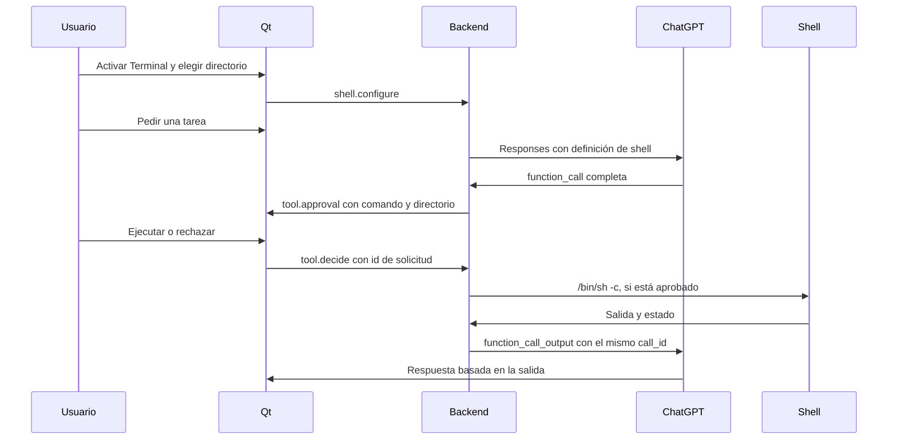

# Integración de shell

La implementación adapta [GUIA-LLM-TERMINAL.md](../GUIA-LLM-TERMINAL.md) al backend
Python de Agent Shell. OpenCode sirve como referencia de arquitectura; la aplicación
conserva su sesión propia de ChatGPT y no depende de OpenCode ni de Codex.

## Fronteras de ejecución

`ChatGPTClient` anuncia una función `shell` con un único argumento `command`.
La solicitud usa `store: false`, streaming, esquema estricto y
`parallel_tool_calls: false`. Aun así, el backend valida las llamadas y procesa
secuencialmente cualquier lote recibido. No interpreta órdenes de texto libre
ni de bloques Markdown. Espera siempre una respuesta completada; los fragmentos
de argumentos no provocan ejecución. Si el resumen final trae `output` vacío,
reconstruye los elementos completos recibidos en `response.output_item.done`,
conservando su orden. Recibir ese evento sin `response.completed` tampoco ejecuta nada.

`shell.py` valida JSON, nombres de campos, longitud y caracteres NUL. El modelo
no puede escoger directorio, timeout, ejecución de fondo ni aprobarse con un
argumento adicional. Un argumento inválido o una herramienta desconocida produce
un resultado de error que permite al modelo corregir la solicitud.

El backend crea un identificador de aprobación nuevo y lo vincula al turno.
`tool.decide` sólo acepta ese identificador pendiente y un booleano real. La
decisión corresponde al comando y directorio ya guardados. Rechazar detiene el
turno; no se solicita otra orden automáticamente. Cambiar directorio o desactivar
terminal durante un turno se rechaza. Una aprobación tardía no ejecuta nada.

Antes de ejecutar se guarda el estado autorizado. Si falla esa escritura, no se
crea el proceso. El ejecutor recibe argumentos validados y aprobados; nunca guarda
una regla de aprobación permanente.

## Procesos y límites

La ejecución utiliza `/bin/sh -c` con stdin cerrado y stdout/stderr combinados.
El entorno incluye únicamente `PATH`, `LANG` y `TERM`; no hereda las demás variables
del backend ni inicia un perfil de login. Las herramientas instaladas sólo en
perfiles interactivos pueden necesitar rutas explícitas.

El timeout es de 120 segundos y la salida se limita a 16000 caracteres Unicode.
La salida adicional se drena sin almacenarla; un indicador señala el recorte.
Los fragmentos UTF-8 se decodifican de forma incremental y se publican como texto
plano, con actualizaciones agrupadas cada 250 ms.

Cada proceso se crea en un grupo propio. **Detener**, timeout y cierre normal
terminan el grupo con SIGKILL. No se gestionan PTY, entrada interactiva ni jobs de
fondo; los descendientes del grupo se terminan al salir la orden principal.
Un programa que cree otra sesión puede escapar del grupo. Un cierre forzado del
backend también puede dejar procesos vivos: esta función no es una sandbox.

El directorio elegido no restringe rutas absolutas ni impide cambiar de carpeta
desde un comando. La revisión del comando y los permisos del usuario son la
frontera de autorización de esta primera integración. La salida aprobada entra
en el contexto enviado a ChatGPT.

El bucle admite hasta ocho solicitudes al modelo y ocho comandos por turno.
La última solicitud debe finalizar la respuesta; si vuelve a pedir herramientas,
el turno termina por límite sin ejecutar esas nuevas llamadas.

## Historial y continuación

El JSON conserva los mensajes visibles, `tool_calls` y un `context` opcional con
los elementos de Responses. Llamadas y resultados conservan el mismo `call_id`;
los mensajes conservan `phase`. Los elementos de razonamiento se conservan como
contenido cifrado y no se publican a Qt; el razonamiento en texto no se almacena.
Esto permite continuar con `store: false`, sin threads remotos. La conexión sigue
la [documentación de llamadas a funciones](https://developers.openai.com/api/docs/guides/function-calling)
y de [contexto de Responses](https://developers.openai.com/api/docs/guides/conversation-state).

Los chats anteriores se convierten desde sus mensajes cuando se activa la shell.
Recuperar una llamada pendiente o en ejecución la muestra como interrumpida y
completa su resultado de contexto con ese estado. Nunca se reejecuta al abrir el
chat. No se garantiza conocer el efecto final de una orden tras un cierre forzado.

La terminal comienza desactivada tras reiniciar; el directorio inicial viene de
`AGENT_SHELL_WORKSPACE` / `--workspace` o del directorio del backend. Activación y
directorio elegidos desde Qt duran hasta cerrar la aplicación.

## Validación

Las pruebas ejercitan procesos locales en carpetas temporales: salida, Unicode,
códigos de error, límite, timeout, cancelación de descendientes y entorno mínimo.
El servicio HTTP local solicita llamadas estructuradas para verificar aprobación,
rechazo, argumentos inválidos, persistencia, continuación y límites del bucle.
La prueba Qt recorre un comando `pwd` real, tarjetas e historial. Estas pruebas
no validan por sí mismas la disponibilidad de herramientas en una cuenta real.

El 2026-10-11 se comprobó también el ciclo con la sesión real de Agent Shell y
`gpt-6.1-sol`: petición estructurada de `pwd`, aprobación limitada a esa orden en
una carpeta temporal, ejecución local y respuesta del modelo con la salida real.
Una segunda petición, con Terminal desactivada, recuperó el mismo directorio del
contexto. Este stream entregó los elementos en `output_item.done` y dejó vacío
el `output` de `response.completed`; hay pruebas de regresión para ese formato.
